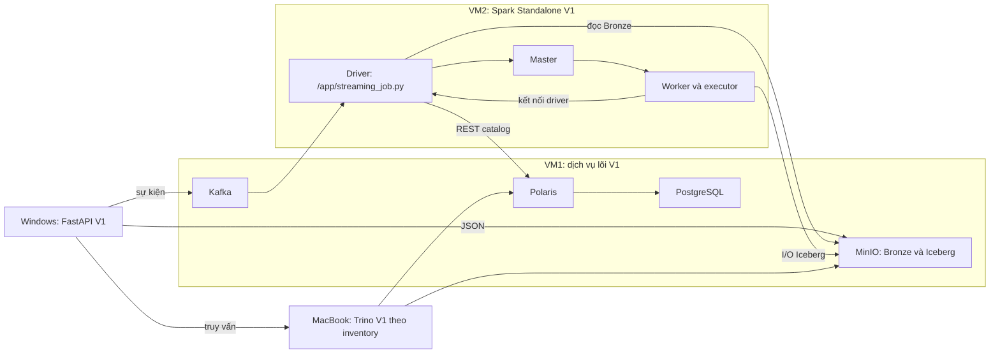
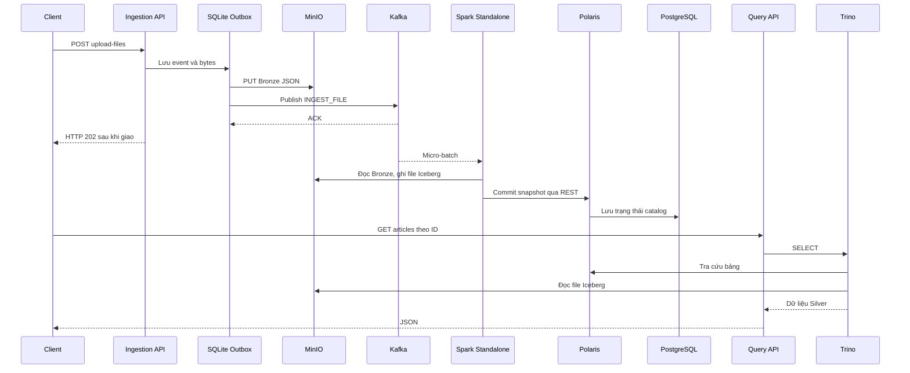

# Hướng dẫn học code và hoàn thiện Vietnamese News Lakehouse

## Mục lục

- [A. Tổng quan](#a-tổng-quan)
- [B. Đọc source](#b-đọc-source)
- [C. Chỉnh sửa từng phần](#c-chỉnh-sửa-từng-phần)
- [D. Cấu hình theo máy](#d-cấu-hình-theo-máy)
- [E. Nghiệm thu end-to-end](#e-nghiệm-thu-end-to-end)
- [F. Lộ trình học](#f-lộ-trình-học)

## A. Tổng quan

Lakehouse lưu JSON gốc ở Bronze (MinIO), chuẩn hóa và hợp nhất theo `article_id` ở Silver (Iceberg), rồi phục vụ đọc qua Trino. Kafka chuyển sự kiện. Polaris quản lý REST catalog và dùng PostgreSQL để lưu trạng thái catalog. File dữ liệu và metadata Iceberg nằm trong object store. Gold hiện là SQL minh họa.

**Đã đối chiếu source:** checkout `main`, baseline `3dc0429` và các sửa đổi local, gồm bộ lọc `article_id`. **Đã ghi nhận:** bằng chứng runtime lịch sử trong [inventory](runtime-inventory.md). **CHƯA KIỂM CHỨNG:** runtime hiện tại của VM1, VM2, Windows và Trino, cùng toàn bộ E2E V2. Xem [handoff](../CODEX_LAKEHOUSE_HANDOFF.md) và [rà soát V2](v2-readiness.md). Những nhận định scaffold trong handoff cần đọc theo thời điểm bàn giao.



MacBook và Windows là máy phát triển. V2 tách hai API, có hai Compose project và có thể nghiệm thu trên một Docker host. Dịch vụ lõi staging phải cấp riêng. Cùng tên bridge network trên hai máy không tạo kết nối liên host.



## B. Đọc source

### 1. Infrastructure và Docker

| File | Input, output và quan hệ | Trạng thái |
| --- | --- | --- |
| [compose.yaml](../infrastructure/docker/compose.yaml) | Snapshot `vnnews`. Kafka 3.9.1 có KRaft controller `9093`, listener `kafka:19092` và LAN `9092`. `pgsty/silo` có S3 `9000`, console loopback `9001`. PostgreSQL 16 có healthcheck. Polaris 1.8.0 chờ bootstrap exit 0, bootstrap chờ DB khỏe. | Snapshot V1, dùng volume và địa chỉ LAN V1. |
| [compose.staging.yaml](../infrastructure/docker/compose.staging.yaml) | `V2_ENV_FILE`, `V2_TRINO_IMAGE` → `ingestion-v2`, `query-v2`, `trino-v2`. Mount catalog read-only, volume `v2-outbox`, các cổng loopback `18000`, `18001`, `18080`. | Compose config đã pass local. Kafka, MinIO, Polaris, PostgreSQL staging ở ngoài file. |
| [compose.vm2.yaml](../infrastructure/docker/compose.vm2.yaml) | Master/Worker dùng `vn-news-spark:3.5.7`; driver `vn-news-stream-v2:3.5.7`; bind `V2_SPARK_JARS_DIR` và volume `v2-checkpoint`. Network external `vnnews-v2-staging`. | Có cấu hình. `depends_on` chỉ đặt thứ tự khởi động, cần đo readiness. |
| [compose.production.yaml](../infrastructure/docker/compose.production.yaml) và [configs](../configs/) | `services: {}` và YAML môi trường mô tả. API/Spark đọc env. | Placeholder. |

Hai [Dockerfile ingestion](../services/ingestion-api/Dockerfile) và [query](../services/query-api/Dockerfile) dùng Python 3.12 slim, Uvicorn cổng 8000, UID 65532, healthcheck HTTP `/health`. Ingestion tạo `/state/v2` cho SQLite. Các file [requirements ingestion](../services/ingestion-api/requirements.txt) và [query](../services/query-api/requirements.txt) pin thư viện trực tiếp: FastAPI/Pydantic, multipart, boto3 và confluent-kafka ở ingestion, `trino` ở query. Build tái lập còn cần khóa base digest, dependency bắc cầu và thử kiến trúc CPU đích.

### 2. FastAPI Ingestion và Query

Mở [ingestion main.py](../services/ingestion-api/src/main.py). `Article` yêu cầu `article_id`, `title` cho CRUD. `article_key()` trim và giới hạn ID 256 ký tự. `upload()` nhận multipart `files`, tối đa 10 file, 10 MiB/file và 50 MiB tổng. Nó kiểm tra tất cả file trước `deliver()`, nhận object, list hoặc object bọc `articles`, đọc UTF-8 BOM. Upload kiểm tra hình dạng và ID; Spark chuẩn hóa trường nội dung. Giới hạn trong handler nên đi kèm giới hạn body ở reverse proxy.

`create()` và `update()` gọi `mutate()` sinh `UPSERT`; PUT ưu tiên ID ở URL dù body vẫn cần ID. `delete()` gửi `DELETE`. `deliver()` lưu cả nhóm vào outbox rồi giao từng event. `202` xác nhận đã giao Kafka; GET có thể chưa thấy. `503` có thể xuất hiện sau khi một số event đã gửi. `/health` là liveness của tiến trình.

[Query main.py](../services/query-api/src/main.py) dùng `connection_factory()` tạo kết nối Trino, yêu cầu catalog/schema `_v2`, timeout 5 giây và `max_attempts=2`. `articles()` lọc tombstone, sắp xếp theo ID, giới hạn 1–100, bind ID bằng `?`, đóng cursor/connection, trả `count` và `articles` gồm ID, tiêu đề, nguồn, loại. `count` là số hàng trả về. Lỗi truy vấn trả `503`. Cần kiểm thử binding trên Trino thật và thêm readiness tách biệt.

```json
{"article_id":"lab-001","title":"Tin thử nghiệm","source":"synthetic","category":"cong-nghe"}
```

### 3. Producer, Bronze và Outbox

[settings.py](../services/ingestion-api/src/settings.py) có `Settings.load()` đọc endpoint, bucket, Kafka, đường dẫn SQLite và kiểm tra hậu tố `-v2`. [adapters.py](../services/ingestion-api/src/adapters.py) có `create_outbox()` tạo S3 client và Producer. Closure `store()` PUT JSON; `publish()` dùng `acks=all`, idempotent producer, callback và `flush(9)`. Input là `(kafka_key, event)`; thiếu ACK gây lỗi. Một broker vẫn là một điểm lỗi.

[Outbox](../services/ingestion-api/src/outbox.py) lưu event/bytes trong `add()`. `deliver()` dùng hai transaction: PUT Bronze, lưu `stored=1` và bỏ payload; sau đó kiểm tra event cũ cùng key, publish và ghi `sent=1`. `pending_ids()` liệt kê event chờ theo `rowid`. `python -m src.adapters` retry từ cùng DB và dừng tại lỗi đầu tiên. Crash sau PUT có thể PUT lại cùng key. Mất ACK hoặc crash trước `sent=1` có thể publish trùng. POST lại sinh ID mới. Network I/O trong transaction giữ khóa ghi SQLite, row đã gửi chưa có retention.

```json
{"op":"INGEST_FILE","event_id":"synthetic-1","s3_key":"bronze_raw/00000000000000000000000000000001.json"}
```

Event upload thật còn có `file_id`, `filename`, `received_at`. Key upload là `file_id`, CRUD là `article_id`: cùng bài có thể đi qua nhiều partition. Ordering theo partition chưa đủ cho ordering theo bài.

### 4. Spark Structured Streaming

Đọc [Dockerfile](../pipelines/spark/Dockerfile) → [run.sh](../pipelines/spark/run.sh) → [submit.py](../pipelines/spark/src/submit.py) → [main.py](../pipelines/spark/src/main.py). Dockerfile copy `src/` và runner vào `/app`, thừa hưởng dependency từ base image. Runner kiểm sáu JAR offline có dữ liệu, gồm Kafka connector Spark 3.5.7/Scala 2.12 và Iceberg runtime/AWS 1.10.1. Cần xác minh checksum JAR, Python và boto3 trong base.

`Settings.load()` trong [config.py](../pipelines/spark/src/config.py) ràng buộc topic/bucket `-v2`, warehouse `_v2`, checkpoint dưới `file:///state/v2/` và table `lake_v2.news_db_v2.articles`. `main()` tạo SparkSession có Iceberg extensions, REST OAuth và S3FileIO. Client mode dùng master `spark://spark-master-v2:7077`, hostname driver `spark-stream-v2`, 1 GiB driver, 1 GiB executor, 2 executor cores. Worker phải kết nối ngược được driver. Kafka bắt đầu `earliest` khi có checkpoint mới, tối đa 20 offsets mỗi trigger, trigger 5 giây. `process()` sắp `(partition, offset)`, đọc về driver qua `toLocalIterator()`, gọi `prepare_batch()` rồi `merge()`. `BATCH_FAILED` giữ checkpoint và phát sinh lỗi; `BATCH_OK` báo batch và số ID.

[streaming_job.py V1](../pipelines/spark/reference/streaming_job.py) có `normalize()`, `upsert()`, `delete()`, `handle_event()` và `process_batch()` theo baseline V1. Checksum trong inventory là bằng chứng lịch sử. V2 vào bằng `submit.py`; so hash VM2 theo D trước khi kết luận drift.

### 5. Validation, transform và writer

| File và hàm | Input → output và giới hạn |
| --- | --- |
| [ingestion.py](../pipelines/spark/src/ingestion.py), `bronze_reader()`, `decode_event()` | Chỉ đọc key `bronze_raw/` + 32 hex thường + `.json`. GET giới hạn, luôn đóng body. Decoder yield `(deleted, row)` cho `INGEST_FILE`, `UPSERT`, `DELETE`. Lỗi làm fail batch. |
| [validation.py](../pipelines/spark/src/validation.py), `article_rows()`, `article_id()` | Tối đa 10 MiB UTF-8 BOM → list dict, từ object/list/`articles`. ID là string trim, dài 1–256. |
| [transformations.py](../pipelines/spark/src/transformations.py), `prepare_batch()` | Ép trường về string, `None` thành `""`, giữ thao tác cuối theo ID theo thứ tự được truyền vào. Trần 10.000 mutation và 20 MiB text tính trước khi gộp. |
| [iceberg_writer.py](../pipelines/spark/src/iceberg_writer.py), `merge()` | Tuple + batch ID → DataFrame theo `SCHEMA` → temp view → một MERGE → dọn view. Update chỉ khi batch ID lớn hơn. Insert cả tombstone khi ID chưa có. |

UPSERT rồi DELETE `lab-001` trong cùng batch cho `("lab-001", "", "", "", "", "", True)`. Sau MERGE, `_batch_id` bảo vệ replay cùng batch; INSERT mới vẫn cần kiểm chứng khi có cạnh tranh writer. Duplicate event ở batch khác và event đến muộn chưa có policy. Tạo checkpoint mới cho bảng đã có dữ liệu làm batch ID quay về thấp và có thể bỏ qua cập nhật hợp lệ.

### 6. Iceberg, Polaris, PostgreSQL và SQL

[articles-v2.sql](../sql/silver/articles-v2.sql) là Spark SQL, tạo namespace và bảng Silver. `published_at` hiện là string. `_deleted` và `_batch_id` bắt buộc. `IF NOT EXISTS` không migrate schema đã tồn tại. [topic_stats.sql](../sql/gold/topic_stats.sql) là SELECT minh họa trên V1. Khi chuyển Gold sang V2, áp dụng điều kiện tombstone và xác định timezone trước khi thống kê theo thời gian.

[provision_catalog.py](../infrastructure/polaris/provision_catalog.py) là V1. `api()` gọi REST, `create_or_existing()` bắt 409, `main()` cấp catalog/role/grant/principal và lưu credential một lần vào `client.env`. 409 chỉ cho biết đối tượng tồn tại, cần so config/quyền trước khi coi là provisioning đúng. Dùng logic này làm tài liệu tham khảo khi thiết kế bootstrap V2. [001-schema.sql](../infrastructure/docker/postgres-init/001-schema.sql) tạo `polaris_schema` lúc init data directory mới. Thay file không migrate database đã có. Phục hồi cần phối hợp PostgreSQL, object Iceberg và checkpoint.

### 7. Trino

[lake.properties](../trino/catalog/lake.properties) trỏ LAN VM1 theo snapshot. [lake_v2.properties](../trino/catalog/lake_v2.properties) dùng REST OAuth2, realm `POLARIS`, S3 path-style, credential env và tắt vended credentials. Tên file tạo catalog `lake_v2` cho Query API. `POLARIS_WAREHOUSE` chọn catalog phía Polaris. Trino cần truy cập cả Polaris và MinIO. Nếu thấy bảng nhưng SELECT lỗi, kiểm tra S3 endpoint và quyền đọc object. Kiểm tra bind ID và tốc độ quan sát snapshot mới trong staging.

### 8. Tests, scripts và CI

- [test_apis.py](../scripts/test_apis.py) có `ApiTests`, dùng TestClient, SQLite tạm thật, mock MinIO/Kafka/Trino. `StagingSmokeTests` mock HTTP với trang đầu đầy. Thư mục test trong hai service có `.gitkeep`; test đang chạy từ script.
- [test_batch.py](../pipelines/spark/tests/test_batch.py) có `BatchTests` cho JSON/BOM, ID sai, tombstone, SQL MERGE với Spark mock. Chưa có executor và Iceberg commit thật.
- [check-local.sh](../scripts/check-local.sh) gọi [scan-secrets.mjs](../scripts/scan-secrets.mjs), `bash -n`, Compose config và deploy preview. `--staged` quét toàn index. [validate.yml](../.github/workflows/validate.yml) chạy Node 22/Python 3.12, requirements-test, hai bộ test và check-local trên PR/push/manual. Chưa có build/deploy E2E trong CI.
- [deploy-vm1.sh](../scripts/deploy-vm1.sh) và [deploy-vm2.sh](../scripts/deploy-vm2.sh) chỉ in revision và preview. [control-v1.sh](../scripts/control-v1.sh) dùng SSH status. [import-v1.sh](../scripts/import-v1.sh) sao chép snapshot về `legacy-import/`, có thể promote khi đích thiếu hoặc placeholder. [import-api.ps1](../scripts/windows/import-api.ps1) từ chối ghi đè API đã chỉnh. Thông báo Query API scaffold trong script thuộc thời điểm import.
- [smoke_staging.py](../scripts/smoke_staging.py) có `request()` timeout 10 giây và `main()` kiểm tra health/GET mặc định. Chế độ ghi upload bài thử và poll đúng ID trong khoảng 90 giây. Test mock chưa chứng minh E2E.


## C. Chỉnh sửa từng phần

| Thứ tự | File cần sửa | Hiện trạng | Vấn đề | Cần viết lại/bổ sung | Cách kiểm thử |
| --- | --- | --- | --- | --- | --- |
| 1 | `scripts/test_apis.py`, `services/ingestion-api/src/main.py` | Đã có route và test mock | Hợp đồng Windows và lỗi từng ranh giới chưa chốt | Test contract trước, sửa validation có bằng chứng | Bộ test API |
| 2 | `pipelines/spark/Dockerfile`, `pipelines/spark/run.sh`, `infrastructure/docker/compose.vm2.yaml` | Base/JAR offline và network riêng | Thiếu provenance, readiness, khả năng nối driver | Manifest, verify build, kiểm tra worker | Compose config, build/run staging |
| 3 | `services/ingestion-api/src/outbox.py`, `adapters.py` cùng thư mục | SQLite và retry thủ công | ACK mơ hồ, lock khi I/O, retry POST sinh event mới | Hợp đồng idempotency, phục hồi, metrics, retention | Test fault injection và broker staging |
| 4 | `pipelines/spark/src/main.py`, `ingestion.py`, `validation.py`, `transformations.py`, `iceberg_writer.py` cùng thư mục | Fail batch, gộp theo ID, guard batch ID | Poison event, ordering xuyên partition, duplicate ở batch khác | Quy tắc phiên bản sự kiện, quarantine có dấu vết | Unit, MERGE và replay staging |
| 5 | `infrastructure/polaris/provision_catalog.py` làm tham chiếu, `sql/silver/articles-v2.sql` | Provisioning V1, DDL V2 | Thiếu bootstrap V2 và migration schema | Công cụ V2 riêng, migration đã duyệt | Chạy hai lần trên staging riêng, kiểm quyền |
| 6 | `trino/catalog/lake_v2.properties`, `services/query-api/src/main.py`, `scripts/smoke_staging.py` | REST/S3 và lookup ID | Chưa thử OAuth, binder, độ trễ và lỗi thật | Readiness và smoke theo từng chặng | SELECT thật, GET đúng ID, case 503 |
| 7 | `.github/workflows/validate.yml`, `scripts/check-local.sh`, `infrastructure/docker/compose.production.yaml` | Validation và placeholder | Thiếu release gates, recovery và observability | CI integration cách ly, checklist trước production | CI, diễn tập restore và rollback |

**1. Khóa hợp đồng API bằng test.** Mở `upload()`, `Article`, `article_key()` và `update()` rồi đọc `ApiTests.test_multi_upload_and_validation` và `test_crud_and_query_contract`. So route, payload, response và status với source `app.py` Windows đã được phép đọc. Thêm case BOM, danh sách rỗng, ID trắng, ID URL khác body, quá giới hạn và request nhiều file có một file lỗi. Sau đó mới sửa validator chung trong phạm vi service nếu quan sát thấy lệch. Acceptance gồm trả 400/413/422 đúng phạm vi và chưa gọi adapter nếu request invalid. Chạy `python -B scripts/test_apis.py`. Nếu cần đổi hợp đồng Windows, giữ route cũ hoặc version riêng; rollback bằng bản API trước khi đổi contract.

**2. Làm cho Spark build lại được.** Mở `run.sh`, đọc mảng `jar_names` và lệnh `spark-submit`; đối chiếu Dockerfile và ba service VM2. Ghi image ID/digest, SHA-256 JAR, Spark/Scala/Python/boto3 và kiến trúc image. Thêm bước kiểm tra checksum trước submit, sau đó đo Worker đăng ký và executor có kết nối driver. Dùng `bash scripts/check-local.sh`, rồi các lệnh build đã duyệt ở D. Kỳ vọng build từ artifact đã chốt, thiếu/sai JAR fail rõ, Worker nhận đủ cores. Đổi base hoặc classpath có thể làm connector lệch phiên bản. Giữ image đã duyệt và checkpoint tương ứng để quay lại.

**3. Hoàn thiện Outbox theo từng ranh giới.** Đọc `Outbox.add()`, `deliver()`, `pending_ids()` cùng `publish()` trong `create_outbox()`. Vẽ trạng thái `pending → stored → sent` trước khi sửa. Giữ event ID và Bronze key qua retry. Nếu thêm idempotency cho client, lưu khóa duy nhất và fingerprint payload cùng transaction; cùng khóa cùng payload trả kết quả cũ, khác payload phải bị từ chối theo contract đã chốt. Thêm retry có timeout/backoff và cơ chế nhận việc tránh nhiều worker xử lý cùng row trước khi dời I/O khỏi transaction. Bổ sung test mất ACK, PUT lỗi, crash giả lập sau PUT, hai event cùng key, phân biệt 503 pending và 202. Chạy bộ API và thử broker staging. Kỳ vọng không mất event và đo được pending age. Backup SQLite trước migration; bản rollback phải hiểu schema đã nâng cấp hoặc phục hồi copy staging đã kiểm chứng.

**4. Chốt semantics ETL trước khi tối ưu.** Mở `process()`, `decode_event()`, `prepare_batch()` và `merge()`. Tách lỗi dữ liệu cố định khỏi lỗi S3/Kafka tạm thời. Thiết kế revision theo bài từ nguồn có thẩm quyền, hoặc chuẩn hóa mutation theo key trước khi dựa vào partition ordering. Chốt tie-breaker cho trùng revision. Nếu thêm DLQ, lưu tọa độ topic/partition/offset và lý do đã che nội dung nhạy cảm; chỉ cho batch tiến khi bản ghi lỗi được lưu bền vững và có quy trình replay. Giữ giới hạn bytes và số mutation. Thêm `BatchTests` cho late UPSERT sau DELETE, event trùng khác batch, lỗi key, quá trần, rồi kiểm thử snapshot thật. Chạy `(cd pipelines/spark && python -B -m unittest discover -s tests -v)`. Đổi semantics có thể làm kết quả replay khác; tách bảng/checkpoint khi không tương thích.

**5. Chuẩn hóa catalog và schema.** Đọc `api()`, `create_or_existing()` và `main()` của provisioning V1 để hiểu REST và phân quyền. Viết tooling V2 riêng với kiểm tra target rõ ràng, preview, kiểm tra warehouse hiện hữu và quyền tối thiểu. Tách bootstrap DB khỏi migration có version. Dùng `articles-v2.sql` làm baseline và thêm migration tiến/lùi đã review nếu đổi kiểu cột. Test mock phản hồi thành công/409/sai warehouse và thử chạy hai lượt trên staging. Kiểm `SHOW TABLES` và SELECT ở E. Nếu drift thì dừng, giữ catalog hiện hữu để đối chiếu. Diễn tập phục hồi phối hợp Polaris DB và object store trước khi đổi schema có dữ liệu.

**6. Nghiệm thu truy vấn.** Mở `connection_factory()`, `articles()` và `smoke_staging.main()`. Giữ bind parameter và lọc tombstone. Thêm readiness kiểm dependency với timeout riêng và thông báo an toàn; giữ `/health` cho liveness. Bổ sung test truy vấn thất bại và cursor close khi ném lỗi, lookup ID chứa dấu nháy trên staging, GET sau commit và GET sau DELETE. Chạy test API rồi E. Kỳ vọng SQL lỗi có thể phân biệt với bảng thật sự rỗng, GET theo ID không phụ thuộc thứ tự trang. Rollback bằng image Query API và catalog config trước đó.

**7. Bổ sung release gates sau khi staging ổn định.** Mở job `local-checks` trong `validate.yml`. Giữ test nhanh. Thêm job tích hợp cô lập bằng dữ liệu giả, lưu commit/image digest và bằng chứng test, sau đó thêm metrics về pending age, Kafka lag, batch failures và độ trễ từ 202 đến GET. `compose.production.yaml` vẫn để placeholder trong lúc chưa chốt topology, TLS, ACL, HA, backup và SLA. Chạy test ở D/E và rehearsal từ backup. Nếu release lỗi, quay về image/config đã nghiệm thu và kiểm checkpoint/schema trước khi chạy lại.

## D. Cấu hình theo máy

### MacBook và Windows

Mở root chứa `README.md` bằng Zed hoặc Codex. Dùng Git để đọc diff trước và sau mỗi bài tập. Tạo branch học tập khi đã lưu các thay đổi đang làm. Đồng bộ bằng private remote đã duyệt, review scan và diff trước khi commit/push. Mac dùng Bash và Python 3.12, Node 22+, Docker Desktop với Compose v2. Windows dùng PowerShell cho Python/Git và Git Bash cho `check-local.sh`; Docker Desktop cần engine phù hợp Linux container.

Bash trên macOS/Linux, từ root:

```bash
git status --short
git log -1 --oneline
python3.12 -m venv "$HOME/.venvs/vnlakehouse"
source "$HOME/.venvs/vnlakehouse/bin/activate"
python -m pip install -r requirements-test.txt
python -B scripts/test_apis.py
(cd pipelines/spark && python -B -m unittest discover -s tests -v)
bash scripts/check-local.sh
git diff --check
```

PowerShell, từ root:

```powershell
git status --short
py -3.12 -m venv "$env:USERPROFILE\.venvs\vnlakehouse"
$Python = "$env:USERPROFILE\.venvs\vnlakehouse\Scripts\python.exe"
& $Python -m pip install -r requirements-test.txt
node scripts/scan-secrets.mjs
& $Python -B scripts/test_apis.py
Push-Location pipelines/spark
try { & $Python -B -m unittest discover -s tests -v } finally { Pop-Location }
bash scripts/check-local.sh
```

Venv đặt ngoài repo để scanner tránh artifact. Nếu Windows báo thiếu `bash`, chạy dòng cuối từ Git Bash đã cài. Nếu cần thử HTTP/OpenAPI cục bộ ngoài Compose, cài requirements từng service vào venv riêng, chạy `python -m uvicorn src.main:app --host 127.0.0.1 --port 18000` từ `services/ingestion-api`, và tương tự từ `services/query-api` với `18001`. Cung cấp env staging trước khi gọi endpoint nghiệp vụ; đổi `OUTBOX_DB` sang thư mục ghi được trên host và `TRINO_HOST` sang host thật nếu chạy ngoài Docker. Health và OpenAPI có thể quan sát qua `/health` và `/openapi.json`. Nguồn Windows từng ghi `D:\Downloads\cty\lakehouse\news-api\app.py`; đọc bản hiện tại và so contract, đừng chạy script import để thay API V2.

### VM1, VM2 và Trino

Các lệnh dưới đây chạy **tại máy tương ứng**, với quyền đã được cấp. Hostname/IP LAN trong snapshot là dữ liệu lịch sử. Kiểm tra IP và cổng công bố trên máy trước khi dùng. Chỉ chia sẻ output đã che bí mật, tránh `docker inspect` toàn bộ hoặc log chứa credential.

| Máy | Dependency và mạng | Kiểm kê chỉ đọc |
| --- | --- | --- |
| VM1 | Linux, Docker Engine/Compose, volume MinIO/Kafka/PostgreSQL. V1 từng dùng `192.168.1.195`, cổng S3 `9000`, Kafka LAN `9092`, Polaris `8181`. PostgreSQL `postgres:5432` nội bộ. Kafka client ngoài Docker phải với tới advertised listener từ container của nó. | `cd ~/vn-news-core && docker compose ps -a`. `docker compose logs --tail=100 kafka minio postgres polaris` để khoanh vùng sau khi kiểm tra log an toàn. Bootstrap exit 0 theo cấu hình là bình thường. |
| VM2 | Linux, Docker/Compose, Spark 3.5.7 và bộ JAR offline, đủ CPU/RAM và volume checkpoint. Địa chỉ lịch sử `192.168.1.197`. Master/Worker/driver V2 cùng network; cổng Spark master `7077`, UI master `8080` nội bộ. | `cd ~/news-spark/docker && docker compose ps -a`. `docker ps -a --filter name=spark`. So hash và image như bên dưới. |
| MacBook Trino V1 | Docker Desktop. Inventory ghi `vn-trino`, config local từng ở `~/vn-news-trino/catalog/lake.properties`. V1 cổng `8080` theo tài liệu. | `docker ps -a --filter name=vn-trino`. Kiểm tra bind và image để xác định bản triển khai. Đối với V2, Compose dùng `trino-v2:8080` nội bộ và loopback `18080` ngoài host. |

```bash
# VM2, sau khi xác nhận tên container đang chạy
sha256sum "$HOME/news-spark/streaming_job.py"
docker exec spark-streaming sha256sum /app/streaming_job.py
docker inspect --format '{{.Config.Image}} {{.Image}}' spark-streaming
docker inspect --format '{{range .Mounts}}{{println .Source .Destination}}{{end}}' spark-streaming
# MacBook, tại repo
shasum -a 256 pipelines/spark/reference/streaming_job.py
docker inspect --format '{{.Config.Image}} {{.Image}}' vn-trino
docker port vn-trino
```

Nếu tên đổi, lấy tên từ `docker ps -a`. Hash khác thì xác định mount so với file baked trong image trước khi sửa. V1 checkpoint từng ở `~/news-spark/checkpoints/main`; giữ riêng. Với VM1, các biến `MINIO_ROOT_USER`, `MINIO_ROOT_PASSWORD`, `POSTGRES_PASSWORD`, `POLARIS_ADMIN_SECRET` thuộc Compose V1. Cấp qua kênh secret của người vận hành. Không in env ra terminal dùng chung.

### Env và chạy staging riêng

Dùng [.env.example](../.env.example) làm đối chiếu. Sao chép ra file riêng ngoài Git và cấp secret bằng cơ chế của môi trường. Ví dụ giá trị chỉ là placeholder. Đảm bảo `/api/catalog` phù hợp base URL Polaris thực tế vì Spark nối thêm `/v1/oauth/tokens`, còn Trino nhận URL OAuth riêng.

| Nhóm | Biến và ví dụ |
| --- | --- |
| Object store | `MINIO_ENDPOINT=http://STAGING_S3_HOST:9000`, `MINIO_BUCKET=vn-news-lake-v2`, `MINIO_ACCESS_KEY=<STAGING_ACCESS_KEY>`, `MINIO_SECRET_KEY=<STAGING_SECRET_KEY>` |
| Kafka | `KAFKA_BOOTSTRAP=STAGING_KAFKA_HOST:9092`, `KAFKA_TOPIC=vn-news-events-v2` |
| Polaris | `POLARIS_URI=http://STAGING_POLARIS_HOST:8181/api/catalog`, `POLARIS_WAREHOUSE=news_lake_v2`, `POLARIS_CLIENT_ID=<CLIENT_ID>`, `POLARIS_CLIENT_SECRET=<CLIENT_SECRET>`, `POLARIS_OAUTH_CREDENTIAL=<CLIENT_ID>:<CLIENT_SECRET>`, `POLARIS_OAUTH_URL=http://STAGING_POLARIS_HOST:8181/api/catalog/v1/oauth/tokens` |
| Trino/API | `TRINO_HOST=trino-v2`, `TRINO_PORT=8080`, `TRINO_USER=lakehouse_v2`, `TRINO_CATALOG=lake_v2`, `TRINO_SCHEMA=news_db_v2`, `OUTBOX_DB=/state/v2/outbox.sqlite3` |
| Spark/Compose | `SPARK_CHECKPOINT=file:///state/v2/checkpoint`, `V2_ENV_FILE=<PATH_TO_STAGING_ENV>`, `V2_SPARK_JARS_DIR=<PATH_TO_VERIFIED_JARS>`, `V2_TRINO_IMAGE=<APPROVED_IMAGE>` |

`V2_MODE` có trong mẫu; các guard chính hiện kiểm tên/đường dẫn. Xác minh cả endpoint, credential, resource và volume trước khi bật write. Tên có hậu tố chưa chứng minh isolation. Topology dễ nghiệm thu nhất là đặt hai project cùng Docker host dành cho staging. Khi thiết kế VM2 tách host, cần network nội bộ VM2 cho Spark và endpoint VM1 staging có thể định tuyến, cùng firewall/ACL; tên bridge network là cấu hình cục bộ từng host.

Sau khi staging đã được cấp và cho phép khởi động, export ba biến Compose theo giá trị đã duyệt rồi chạy từ root trên Bash:

```bash
docker compose -f infrastructure/docker/compose.staging.yaml config --quiet
docker compose -f infrastructure/docker/compose.vm2.yaml config --quiet
docker compose -f infrastructure/docker/compose.staging.yaml build
docker compose -f infrastructure/docker/compose.vm2.yaml build
docker compose -f infrastructure/docker/compose.staging.yaml up -d
docker compose -f infrastructure/docker/compose.vm2.yaml up -d spark-master-v2 spark-worker-v2
# Sau khi Worker đã đăng ký và DDL V2 đã áp dụng bằng Spark SQL
docker compose -f infrastructure/docker/compose.vm2.yaml up -d spark-stream-v2
docker compose -f infrastructure/docker/compose.staging.yaml ps -a
docker compose -f infrastructure/docker/compose.vm2.yaml logs --tail=100 spark-stream-v2
```

`up` ở đây dành cho staging một host. Cấp base image và JAR trước vì runner dùng artifact offline. DDL cần phiên Spark SQL có **cùng REST/S3/JAR** như `main()`. Repo chưa có lệnh migration đóng gói hoàn chỉnh cho khâu này. Nếu driver fail sớm, xem `Missing offline JAR`, network bị thiếu, memory hoặc DNS. Nếu Worker Up nhưng job chờ, kiểm registration/cores, hostname driver và đường kết nối ngược. Nếu SQLite lỗi quyền, kiểm mount `/state/v2` với UID 65532. Nếu Trino lỗi 401/403, kiểm realm, OAuth URL, warehouse và quyền principal.


## E. Nghiệm thu end-to-end

**CHƯA KIỂM CHỨNG trên staging thật.** Chỉ thực hành các bước ghi trên staging đã cách ly và được duyệt. Chuẩn bị commit/image ID, resource matrix ở D, bảng Silver, Worker đã đăng ký, checkpoint mới cho bảng mới, quyền producer/consumer/S3/OAuth, và máy gọi API có thể truy cập loopback staging. Chọn ID duy nhất cho mỗi lượt. Ghi timeline cùng `article_id`, `file_id`, Kafka partition/offset, Spark batch ID và Iceberg snapshot ID khi có. Tránh đính kèm dữ liệu bài thật hoặc credential vào log.

```bash
# Từ Docker host staging, checkout repo
python -B scripts/smoke_staging.py
# Chỉ sau khi duyệt ghi một bài JSON tổng hợp
python -B scripts/smoke_staging.py --write-staging
```

Smoke mặc định đọc hai `/health` và danh sách Query. Chế độ ghi kỳ vọng `STAGING_POST_202` và `STAGING_E2E_OK`; nó giữ lại bài thử. Để tự theo dõi từng chặng, chạy Bash dưới đây thay cho smoke ghi hoặc chọn ID khác:

```bash
id="lab-$(python -c 'import uuid; print(uuid.uuid4().hex)')"
sample_dir="$(mktemp -d)"
printf '{"article_id":"%s","title":"Tin thử","source":"synthetic"}\n' "$id" > "$sample_dir/news.json"
curl -fsS http://127.0.0.1:18000/health
curl -fsS http://127.0.0.1:18001/health
curl -fsS -w '\nHTTP %{http_code}\n' -F "files=@$sample_dir/news.json" \
  http://127.0.0.1:18000/upload-files
curl -fsS -G --data-urlencode "article_id=$id" --data-urlencode "limit=1" \
  http://127.0.0.1:18001/articles
```

| Chặng | Đối chiếu và kết quả mong đợi | Khoanh vùng khi lỗi |
| --- | --- | --- |
| FastAPI → outbox | POST `202`, JSON `status=accepted` và `files[].s3_key`. Nếu `503` pending, ghi event IDs từ response để đối soát. | `400/413/422` kiểm tên file, kích thước và JSON. `503` xem log `ingestion-v2`, quyền/volume SQLite và trạng thái từng event. |
| MinIO Bronze | Trong console/client S3 đã được duyệt, Tra `s3_key` trả về trên bucket V2 và kiểm JSON chứa đúng ID. | So endpoint, bucket, quyền PUT/GET và TLS/path style. Object có mà Kafka thiếu thường cần đối soát outbox. |
| Kafka | Dùng consumer quan sát riêng/read-only trong công cụ quản trị staging để xem topic V2, event `INGEST_FILE` và `s3_key`; ghi partition/offset. | Kiểm advertised listener từ driver, topic, ACL, ACK và pending outbox. Không dùng group/checkpoint của job vận hành để debug. |
| Spark Standalone | `docker compose -f infrastructure/docker/compose.vm2.yaml logs --tail=100 spark-stream-v2`. Kỳ vọng `BATCH_OK`; đối chiếu progress/offset và Worker nhận executor. | Kiểm JAR, driver networking, `BATCH_FAILED`, key Bronze, JSON, giới hạn batch, OAuth và S3. Lỗi dữ liệu cố định cần runbook xử lý, restart đơn thuần có thể lặp lỗi. |
| Iceberg/Polaris | Trên Trino staging, SELECT đúng ID và kiểm `_deleted`, `_batch_id`; xem metadata snapshot để nối timeline commit. | Catalog lỗi kiểm OAuth/realm/warehouse; thiếu table kiểm DDL bằng Spark SQL và namespace. Nếu thấy snapshot nhưng đọc lỗi, kiểm file và quyền S3. |
| Trino → Query API | GET `?article_id=<ID>&limit=1` thấy đúng bài, `count=1`. GET trước commit có thể trả `count=0`. | Nếu SQL trực tiếp có hàng nhưng GET lỗi, kiểm `TRINO_HOST`, catalog/schema, user, binder và điều kiện tombstone. Nếu cả hai rỗng, quay lại Kafka/Spark và đúng ID. |

Chạy SQL bằng client đã kết nối Trino **staging**, thay ID bằng giá trị đã ghi:

```sql
SHOW TABLES FROM lake_v2.news_db_v2;
SELECT article_id, title, _deleted, _batch_id
FROM lake_v2.news_db_v2.articles
WHERE article_id = '<SYNTHETIC_ID>';

SELECT committed_at, snapshot_id, operation
FROM lake_v2.news_db_v2."articles$snapshots"
ORDER BY committed_at DESC
LIMIT 5;
```

### Kịch bản lỗi và phục hồi

Các bài dưới đây cần staging dùng dữ liệu giả. Mỗi lượt lưu kết quả quan sát và so trạng thái trước/sau. Các điều kiện nêu ra là tiêu chí nghiệm thu.

| Kịch bản | Cách thử và kết quả cần chứng minh |
| --- | --- |
| MinIO PUT hoặc Kafka publish lỗi | Trong môi trường test có fault injection, gây lỗi ở một adapter. Kiểm `503`, pending ID, khôi phục kết nối, rồi chạy retry cùng DB theo lệnh dưới. Khi lỗi sau PUT, cùng key/ID được giữ và cuối cùng GET thấy bài. |
| Mất ACK và POST lặp | Giả lập broker nhận trước khi ACK về. Quan sát duplicate có thể tồn tại; tách thử retry cùng event và POST mới. Sau khi có idempotency, POST cùng khóa/cùng payload trả kết quả đã lưu, request khác payload cùng khóa bị từ chối. V2 hiện chưa có bảo đảm này. |
| Replay cùng checkpoint | Tạo fault sau MERGE trước khi Spark ghi nhận hoàn thành batch trên staging. Giữ checkpoint và table cùng cặp, chỉ một driver, chạy lại image tương thích. So giá trị `_batch_id` và trạng thái hàng; replay chính batch không được ghi đè phiên bản mới hơn. |
| Duplicate ở batch mới và late event | Phát cùng `event_id` ở batch khác rồi thử UPSERT cũ đến sau DELETE. Snapshot hiện chỉ có guard batch ID; ghi nhận sai lệch để nghiệm thu policy revision sau khi bổ sung. |
| DELETE/tombstone | Sau khi một ID xuất hiện, gửi DELETE mẫu bên dưới. Iceberg phải còn hàng với `_deleted=true`, GET cùng ID phải rỗng sau commit. Chạy thử cả DELETE cho ID chưa tồn tại trên staging. |
| Poison event và recovery | Đưa event lỗi đã chuẩn bị vào topic thử nghiệm riêng. Hiện kỳ vọng `BATCH_FAILED` và batch chưa hoàn thành. Sau khi có quarantine, kiểm tọa độ offset, lưu bền vững và replay có chủ đích. |
| Restore | Phục hồi PostgreSQL/Polaris, object Iceberg, outbox và checkpoint vào môi trường khác đã duyệt. Đối chiếu snapshot và kiểm lại GET. Không reset offset hoặc xóa checkpoint để làm batch chạy qua lỗi. |

```bash
# Retry các event đang chờ trên đúng instance ingestion V2 đã xác nhận
docker compose -f infrastructure/docker/compose.staging.yaml exec ingestion-v2 \
  python -m src.adapters
# Xóa logic duy nhất bài tổng hợp của lượt thử, sau khi đã đối chiếu ID
curl -fsS -X DELETE "http://127.0.0.1:18000/articles/$id"
curl -fsS -G --data-urlencode "article_id=$id" http://127.0.0.1:18001/articles
```

## F. Lộ trình học

| Giai đoạn | Mục tiêu, kiến thức và file làm việc | Thay đổi, kiểm thử và tiêu chí hoàn thành | Rủi ro và rollback |
| --- | --- | --- | --- |
| 1. Đọc và test local | Học HTTP, JSON, dependency injection, unittest. Đọc `services/ingestion-api/src/main.py`, `scripts/test_apis.py`, `pipelines/spark/tests/test_batch.py`. | Chạy bộ lệnh D, lần theo một upload từ request đến mock producer. Hoàn tất khi giải thích được vì sao 202 chưa xuất hiện ngay ở GET. | Giữ bài tập ở branch riêng; so diff trước khi bỏ thay đổi thử. |
| 2. Chuẩn hóa source và Docker | Học image/layer, bind mount, named volume, network, Spark client mode. Làm `pipelines/spark/Dockerfile`, `pipelines/spark/run.sh`, hai Compose V2 và `.env.example`. | Đối chiếu inventory, chốt artifact, checksum, topology và readiness. `check-local.sh` pass, build sạch và Worker staging chạy được. | Sai image/JAR hoặc volume có thể chặn job. Quay lại image/config đã duyệt, giữ state. |
| 3. Ingestion API | Học FastAPI contract, SQLite transaction, ACK và idempotency. Làm `services/ingestion-api/src/main.py`, `outbox.py`, `adapters.py`, `settings.py` cùng thư mục và `scripts/test_apis.py`. | Chốt hợp đồng Windows, test validation và failure injection, thêm cơ chế retry/idempotency theo C. Hoàn tất khi retry có dấu vết và không mất bản ghi đã nhận. | Migration outbox có thể cản rollback. Sao lưu, thử restore và ưu tiên schema tương thích. |
| 4. Spark ETL | Học partition, offset, checkpoint, streaming micro-batch. Làm `pipelines/spark/src/main.py`, `ingestion.py`, `validation.py`, `transformations.py`, `iceberg_writer.py` cùng thư mục. | Chốt revision, quy tắc DLQ, giới hạn batch; chạy unit và replay staging với baseline catalog thử được cấp. Hoàn tất khi poison, duplicate, late event và DELETE có kết quả dự đoán được. | Đổi logic replay làm đổi dữ liệu. Giữ checkpoint tương ứng, tách bảng cho thay đổi không tương thích. |
| 5. Iceberg, Polaris và Trino | Học snapshot, REST OAuth, S3 ACL và schema migration. Đọc `infrastructure/polaris/provision_catalog.py`, làm `sql/silver/articles-v2.sql`, `trino/catalog/lake_v2.properties`, `services/query-api/src/main.py`. | Hoàn thiện tooling bootstrap V2 riêng, migration, readiness và query. Hoàn tất khi chạy lặp bootstrap staging, SELECT/snapshot và binder đều pass. | Drift warehouse hoặc quyền quá rộng. Dừng khi mismatch, phục hồi config đã duyệt và diễn tập restore. |
| 6. Staging E2E | Học kiểm tra độ trễ và đối soát xuyên dịch vụ. Làm `scripts/smoke_staging.py`, `docs/operations.md`. | Chạy toàn bộ E với ID tổng hợp và lỗi có kiểm soát. Hoàn tất khi có bằng chứng POST → Bronze/Kafka → Spark → Iceberg → Trino/GET, cả DELETE và phục hồi. | Chạy nhầm target gây ảnh hưởng V1. Duyệt resource matrix trước; rollback chỉ dừng tiến trình staging và giữ volume. |
| 7. Hardening | Học CI/CD, TLS, ACL, HA, observability, RPO/RTO. Làm `.github/workflows/validate.yml`, `docs/security.md`, `docs/operations.md`, `infrastructure/docker/compose.production.yaml` khi được duyệt. | Thêm CI integration, metrics, backup, restore và rollback rehearsal. Tiêu chí là release có digest, audit, kế hoạch sự cố và kết quả diễn tập. | Cutover ảnh hưởng người dùng. Giữ đường phục vụ cũ và phê duyệt chuyển traffic riêng. |

### Năm việc đầu tiên

1. Mở `services/ingestion-api/src/main.py`, đọc `upload()` → `deliver()` cùng test `test_multi_upload_and_validation`.
2. Chạy baseline Python, secret scan và Compose validation ở D; ghi kết quả để so sau mỗi thay đổi.
3. Đối chiếu VM2 chỉ đọc theo D khi có quyền, chốt image, mount, checksum và bộ JAR.
4. So contract với FastAPI Windows rồi thêm test lỗi MinIO/Kafka và retry trên SQLite tạm.
5. Lập danh sách endpoint và tài nguyên staging V2 riêng, chốt bootstrap catalog và DDL trước khi chạy E2E.

**File đầu tiên nên mở** là [Ingestion API main.py](../services/ingestion-api/src/main.py). Bài sửa đầu tiên phù hợp là bổ sung test cho một trường hợp validation còn thiếu, sau đó mới chỉnh phần logic mà test chứng minh cần thay đổi.
