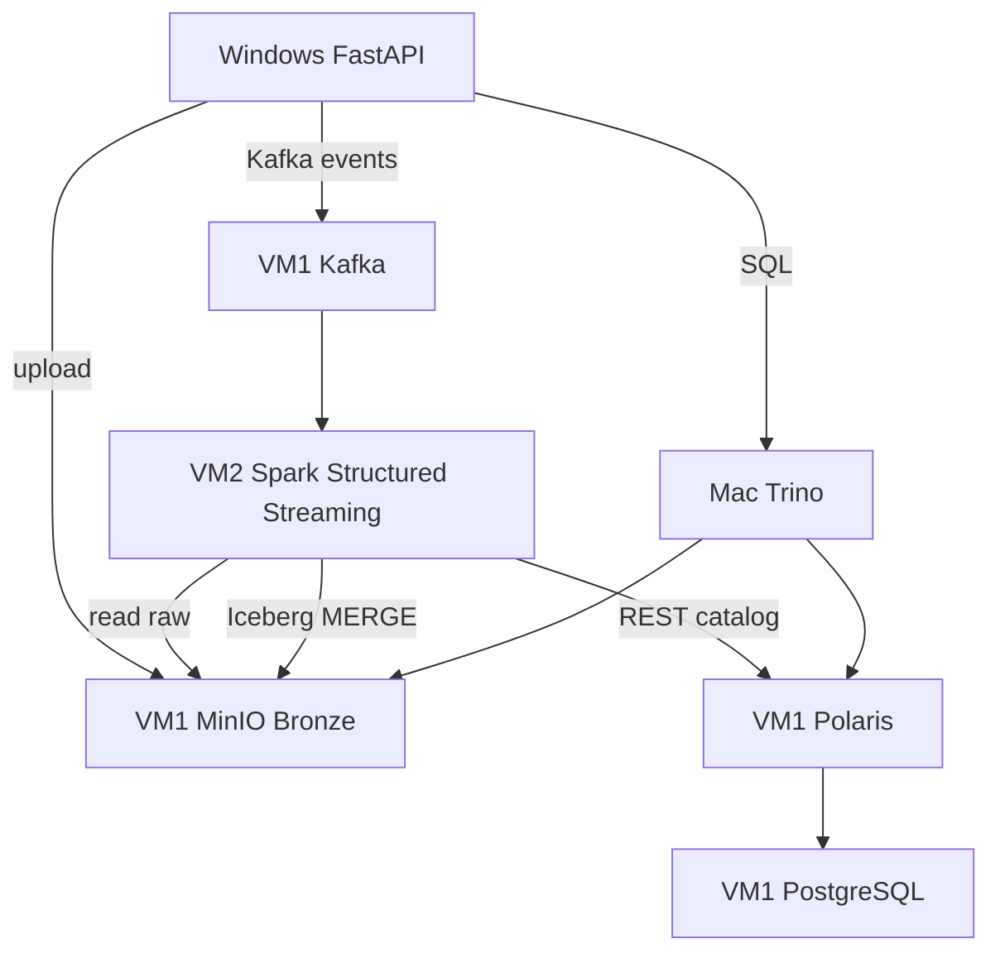

# Current V1 and intended V2

This starter repository lives on MacBook and Windows (Git); runtime V1 remains on remote machines. V2 deployments will require unique resources, security policies and tests before cutting over.
